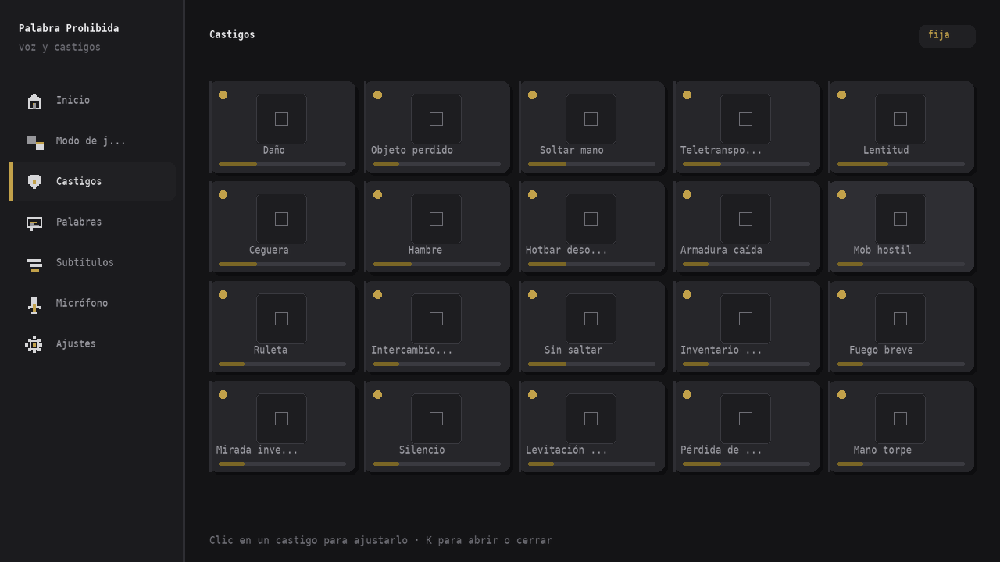
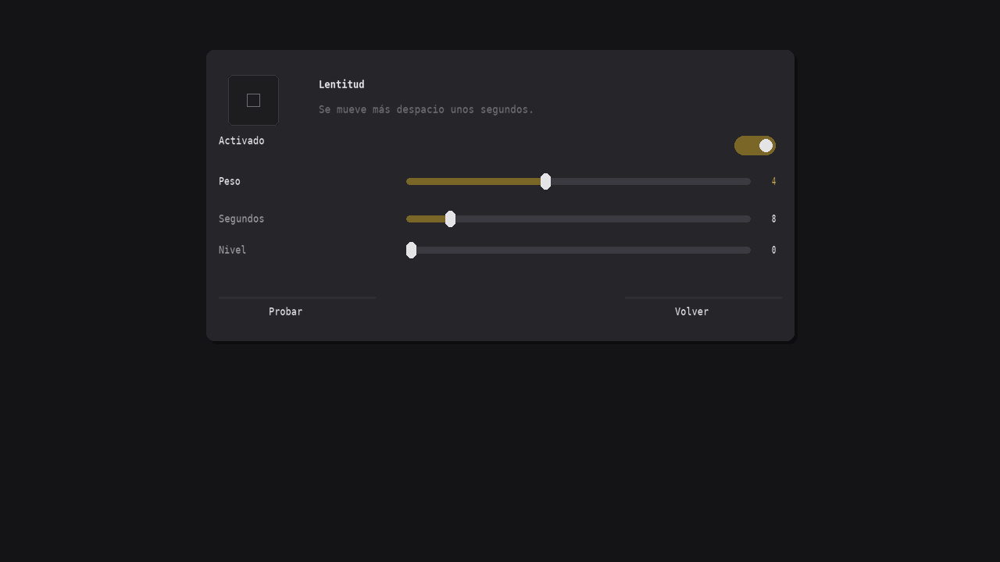

# Palabra Prohibida

Mod de Minecraft (**Fabric, Java 21, Minecraft 1.21.11**) que escucha lo que se dice por
Simple Voice Chat, reconoce el habla **sin conexión** con Vosk y castiga al jugador que
dice la palabra prohibida.

- Reconocimiento local: no hay nube, no hay claves, no sale audio de tu equipo.
- El **servidor es la única autoridad**: el cliente solo muestra y reporta.
- Dos modos: **palabra fija** por jugador y **acumulativo** con lista global oculta.
- 20 castigos configurables, menú propio y editor de posiciones en pantalla.

---

## 1. Estructura de carpetas

```
Prueba-de-agentes/
├── build.gradle                 configuración de Loom y dependencias
├── settings.gradle
├── gradle.properties            versiones (1.21.11, Yarn build.6, loader 0.19.5...)
├── gradlew / gradlew.bat
├── gradle/wrapper/              wrapper de Gradle 9.7.1
├── LICENSE                      MIT
├── README.md
└── src/
    ├── main/java/com/palabraprohibida/
    │   ├── PalabraProhibida.java          entrada común (main)
    │   ├── Pp.java                        constantes y logger
    │   ├── compat/Compat.java             TODA la API que cambió en 1.21.9-1.21.11
    │   ├── util/Json.java                 JSON con cuarentena de archivos corruptos
    │   ├── word/WordHash.java             normalización + FNV-1a 64 con sal
    │   ├── config/                        ServerConfig, PunishmentConfig, Zone
    │   ├── state/                         GameState, StateStore (carpeta del mundo)
    │   ├── punish/                        PunishmentType (los 20), Punisher
    │   ├── server/                        ServerRuntime, ServerCallbacks, Actions
    │   ├── net/                           Payloads (8 paquetes), Net, Sync
    │   ├── command/ModCommands.java       /palabraprohibida ...
    │   └── voice/                         VoicePlugin, SpeechEngine, Resampler, ModelManager
    ├── main/resources/
    │   ├── fabric.mod.json
    │   └── assets/palabraprohibida/       icon.png, lang/{es_es,en_us}.json, textures/gui/icons.png
    ├── client/resources/
    │   └── palabraprohibida.client.mixins.json   (solo cliente: EntityMixin)
    └── client/java/com/palabraprohibida/client/
        ├── PalabraProhibidaClient.java    tecla K, botón en pausa, HUD, paquetes S2C
        ├── ClientState.java               estado sincronizado + subtítulos/avisos
        ├── ClientNet.java                 envíos C2S con canSend
        ├── config/ClientConfig.java       ajustes locales (tamaños, posiciones, modelo)
        ├── voice/VoiceClientBridge.java   eventos de Simple Voice Chat → reconocedor
        ├── hud/HudOverlay.java            subtítulos, panel, avisos, etiquetas
        ├── ui/                            Theme, Draw, MenuScreen, PunishmentScreen, OverlayEditorScreen
        ├── mixin/EntityMixin.java         mirada invertida
        └── ModMenuIntegration.java        integración opcional
```

## 2. Compilar

```bash
chmod +x gradlew && ./gradlew build && ls build/libs
```

Genera `build/libs/palabraprohibida-1.0.0.jar` (más `-sources.jar`). El jar incluye Vosk
(`include`, sin transitivas) y **no** incluye Simple Voice Chat.

> **Aviso honesto sobre la compilación**: todos los nombres se comprobaron contra los
> mappings **Yarn `1.21.11+build.6`** (los del tag, no los de la rama `1.21.11`, que va por
> delante) y contra el código fuente de Fabric API / Simple Voice Chat de esa versión. En el
> Codespace del autor, `compileJava` (el código de servidor y voz) ya compila; la parte de
> cliente se está verificando de la misma forma. El entorno donde se escribió el mod no tenía
> JDK ni acceso a Maven, así que **el `./gradlew build` completo hay que ejecutarlo en tu
> máquina**. La sección 6 lista los puntos delicados y cómo se resolvió cada uno.

## 3. Instalación

### Cliente

1. Minecraft **1.21.11** con **Fabric Loader ≥ 0.18.0** (compilado con 0.19.5).
2. En `mods/`:
   - `fabric-api-0.141.6+1.21.11.jar`
   - **Simple Voice Chat** `voicechat-fabric-1.21.11-2.6.x.jar` (obligatorio). Su número de
     versión es del tipo `1.21.11-2.6.22`, no semver puro, así que el mod lo declara como
     `"voicechat": "*"`: exige que esté presente, sin atar a una versión concreta.
   - `palabraprohibida-1.0.0.jar`
   - opcional: Mod Menu 17.0.0-beta.1
3. Al primer inicio se descarga solo `vosk-model-small-es-0.42` (39 MB) a
   `config/palabraprohibida/model/`, con barra de progreso en el chat/avisos.
4. Tecla **K** para el menú (configurable en *Controles → Palabra Prohibida*), o el botón
   **Palabra Prohibida** en el menú de pausa.

### Servidor

1. Fabric Loader ≥ 0.18.0 y **Fabric API**; el jar del mod en `mods/`.
2. **Simple Voice Chat también en el servidor** y su **puerto UDP 24454 abierto**
   (o el que tengas en `voicechat-server.properties`).
3. El mod es necesario en el servidor (ahí viven las reglas y los castigos) y en el
   cliente (ahí vive el micrófono). Un cliente **sin** el mod puede entrar: no recibe
   paquetes, no ve el menú y no se le aplican los 3 castigos que resuelve el cliente.
4. Archivos:
   - `config/palabraprohibida/server.json` → configuración global (solo admin).
   - `<mundo>/palabraprohibida/state.json` → palabras, contadores y ranking.

## 3.1. Vista previa del menú de castigos

Imágenes generadas con las medidas, colores y textos reales del código (GUI de 640×360 mostrada al doble):

| Pantalla | Archivo |
|---|---|
| Menú principal → Castigos (los 20, con peso y estado) | `docs/preview/menu-castigos.png` |
| Detalle de un castigo con dos parámetros (Lentitud) | `docs/preview/castigo-detalle.png` |
| Castigo con interruptor extra (Mob hostil → Permitir creeper) | `docs/preview/castigo-mob.png` |





Son reconstrucciones estáticas: en el juego los iconos de ítem son los modelos 3D reales de
Minecraft, la fuente es la bitmap del juego y las animaciones (deslizamiento del indicador,
entrada de las tarjetas en ~400 ms) no se ven en una imagen fija.

## 4. Comandos (solo admin: operador o anfitrión)

```
/palabraprohibida modo <fija|acumulativo>
/palabraprohibida palabra <jugador> <palabra>
/palabraprohibida nueva <jugador>
/palabraprohibida castigo <tipo> [jugador]
/palabraprohibida activar
/palabraprohibida desactivar
/palabraprohibida reload
```

## 5. Pruebas recomendadas

### Por modo

| Modo | Prueba | Resultado esperado |
|---|---|---|
| Fija | Cada jugador entra | Recibe palabra aleatoria de la lista de respaldo; los demás la ven sobre su cabeza |
| Fija | El dueño mira su propia etiqueta | No la ve (salvo jugar solo o activar «El dueño ve su palabra») |
| Fija | Otro jugador dice la palabra | Se castiga **al dueño**; quien la dijo recibe «Esa palabra era de X» |
| Fija | Tras el castigo | La palabra cambia a una de las 5 más repetidas por el dueño (o a la lista de respaldo) |
| Fija | Rotación por tiempo | Con `rotationMinutes>0`, la palabra cambia sola |
| Acumulativo | Intervalo configurado | Se añade la palabra más hablada; nunca se muestra en pantalla |
| Acumulativo | Límite alcanzado | Se borra la más antigua |
| Acumulativo | Se dice una palabra activa | Se revela (público/privado), castiga al hablante y se borra |
| Ambos | Reinicio del servidor | Palabras y contadores se conservan |
| Ambos | `state.json` corrupto | Se renombra a `.corrupto` y arranca con valores por defecto |

### Por castigo

`damage`, `item_loss`, `drop_hand`, `teleport`, `slowness`, `blindness`, `hunger`,
`hotbar_shuffle`, `armor_drop`, `mob`, `roulette`, `swap`, `no_jump`, `inventory_lock`,
`fire`, `inverted_look`, `silence`, `levitation`, `xp_loss`, `clumsy_hand`.

Para cada uno, desde el menú **Castigos** (icono → *Probar*) o
`/palabraprohibida castigo <tipo>`:

1. Se aplica solo si está activado y con peso > 0.
2. Respeta creativo/espectador (configurable) y las zonas protegidas.
3. Mensaje corto + sonido de Minecraft.
4. Si no se puede aplicar, se prueba otro castigo activo; si no hay ninguno, avisa.
5. Los tres de cliente (`inverted_look`, `silence`, `clumsy_hand`) se omiten si el
   jugador no tiene el mod.
6. Casos límite: jugador muerto, desconectado a mitad del castigo, `noDeathPunishments`
   activo con poca vida (el fuego se limita), agua o resistencia al fuego (no se prende).

### Permisos y sincronización

- Jugador sin OP: el menú muestra los controles bloqueados («Solo el admin puede
  modificar esto») y `/palabraprohibida` devuelve error.
- El admin cambia un ajuste: los clientes lo ven **al instante** (paquete `ConfigSync`).
- Cambiar de modo con jugadores dentro: no hay que reiniciar; se recalculan palabras.
- Persistencia: reiniciar el servidor conserva modo, palabras y contadores.
- Cliente sin el mod: entra, no recibe paquetes ni sufre castigos de cliente.
- Servidor sin el mod: el menú avisa y nada más se envía.

### Micrófono y modelos

- Sin Voice Chat conectado o micro silenciado: aviso discreto y sin subtítulos.
- Modelo sin descargar: el mod sigue funcionando; al terminar la descarga arranca solo.
- Modelo «preciso» (1,4 GB) sin memoria suficiente: vuelve al rápido y lo avisa.
- Decir una palabra con confianza < 50 % no castiga (salvo «detección rápida», que exige
  verla en dos parciales seguidos).

## 6. Puntos de la API más propensos a fallar (y dónde están)

Los nombres de esta lista son los que más han cambiado entre 1.21.9 y 1.21.11, o los que
la documentación de Yarn no cubre bien. Todos están concentrados a propósito:

1. **`Compat.java`** — `Entity#getEntityWorld()` (el antiguo `getWorld()`) y `Entity#getUuid()`
   (heredado de `UniquelyIdentifiable`, no `getUUID()`); `ServerPlayerEntity` **no** tiene
   `getServerWorld()` ni `getServer()`: se usan `(ServerWorld) player.getEntityWorld()` y
   `world.getServer()`,
   `getPermissions().hasPermission(DefaultPermissions.GAMEMASTERS)`, `MinecraftServer#isHost(PlayerConfigEntry)`,
   `world.playSound(...)` con `SoundEvent` + `SoundCategory` (las constantes de `SoundCategory`
   se buscan por `getName()`), `Registries.STATUS_EFFECT/#getEntry`, `Registries.ATTRIBUTE`,
   `EntityAttributeModifier` (constructor con `Identifier`, `Operation`, `AttributeModifierSlot`).
2. **`net/Payloads.java`** — `CustomPayload.Id`, `PacketCodec.of` (el encoder recibe `(value, buf)`,
   no `(buf, value)`; para métodos estáticos con el buffer primero sería `ofStatic`),
   `RegistryByteBuf#writeString/readString`
   y `PayloadTypeRegistry.playC2S()/playS2C()` (devuelven `RegistryByteBuf`).
3. **`voice/SpeechEngine.java` + `voice/ModelManager.java`** — API de Vosk 0.3.45
   (`Model`, `Recognizer`, `setWords`, `acceptWaveForm`, `getResult/getPartialResult/getFinalResult`)
   y comportamiento de JNA en el jar (extracción de nativas).
4. **`compat/Compat.java` (castigo "no saltar")** — `EntityAttributeModifier` no expone constructor
   en los mappings y las constantes de `Operation` / `AttributeModifierSlot` no tienen nombre,
   así que el modificador se construye por reflexión; si falla, el servidor elige otro castigo.
5. **`client/ui/Draw.java`** — `DrawContext.getMatrices()` devuelve **`org.joml.Matrix3x2fStack`**
   (`pushMatrix/popMatrix/scale`) y `drawTexture` exige un `RenderPipeline`
   (`RenderPipelines.GUI_TEXTURED`). Si cambian, se arregla solo aquí.
6. **`client/ui/*`** — entrada por `glfwGetMouseButton` (no se usan `Click`/`KeyInput`),
   `Screen#render(DrawContext,int,int,float)`, `KeyBinding.Category.create(Identifier)` y el
   constructor `KeyBinding(String, int, Category)` (código GLFW directo).
   Ojo: `Screen#addDrawableChild` es `protected`, así que el botón del menú de pausa se
   añade con `Screens.getButtons(screen).add(button)`; y `Math.round(double)` devuelve
   `long`, de ahí los `(int) Math.round(...)` al posicionar.
7. **`client/hud/HudOverlay.java`** — `HudElement#render(DrawContext, RenderTickCounter)`,
   `Entity#getEyePos()` (en `build.6` no existe `getPos()`),
   `client.options.hudHidden` y la proyección manual de las etiquetas sobre la cabeza
   (si los signos de yaw/pitch cambian, la etiqueta saldría reflejada: es cosmético).
8. **`client/mixin/EntityMixin.java`** — el objetivo es `Entity#changeLookDirection(DD)`;
   si cambia de nombre, hay que actualizar el `method =` del `@Inject`.
9. **`state/StateStore.java`** — `MinecraftServer#getSavePath(WorldSavePath.ROOT)`.
10. **`server/ServerRuntime.java`** — `ServerPlayNetworking.canSend(player, payload.getId())`
   y `ServerPlayNetworking.send(...)`.
11. **`punish/Punisher.java`** — `PlayerInventory#getStack/setStack`, `Entity#dropStack(ServerWorld, ItemStack)`
    (`dropItem` sólo acepta `ItemConvertible`),
    `ServerPlayNetworkHandler#requestTeleport(...)`, `PlayerEntity#dropSelectedItem(boolean)`,
    `setFireTicks`, `getHungerManager().setFoodLevel`, `addExperienceLevels`, y el
    `summon` por comando para el mob hostil (evita depender de las constantes de `EntityType`).

## 7. Notas de diseño

- **Detección**: el servidor manda `hashes` FNV-1a 64 con una sal nueva cada vez que se
  sincroniza. El cliente compara hashes de las palabras finales reconocidas: en modo
  acumulativo no conoce las palabras. Solo los resultados **finales** castigan (los
  parciales cambian y adivinan), con confianza mínima configurable.
- **Audio**: 48 kHz mono 16 bit → FIR pasa-bajos (sinc, Hamming, 33 taps, corte 7 kHz) →
  decimación a 16 kHz, con historia entre cuadros por hablante y ganancia suave hasta ×6.
  Cola acotada de 200 cuadros que descarta lo más viejo; un `Recognizer` por hablante
  (máx. 5 ajenos), liberados por inactividad, al salir del mundo y al cerrar.
- **Rendimiento**: nada pesado en el hilo principal ni en el tick; el menú dibuja en modo
  inmediato con arreglos fijos y sin crear objetos por fotograma.
- **Estado**: `state.json` en la carpeta del mundo y `server.json` en `config/`. JSON
  corrupto → `.corrupto` + valores por defecto. Decaimiento del 10 % cada 10 minutos.

## Licencia

MIT. Ver `LICENSE`.
